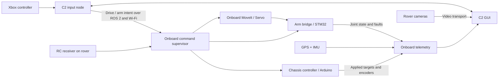

# C2 ↔ onboard compute: ROS 2 implementation plan

Draft for team review, 23 October 2026. Proposed names, rates and limits below are
engineering starting points, not finalized interfaces or competition requirements.
No ROS node or MoveIt controller is implemented yet. Version 0.4 adds a direct
guarded UDP chassis adapter, tested against a local mock; see the update at the end.

## Platform and meaning

Liam likely means **ROS 2 Jazzy Jalisco**. It is a ROS distribution, not a GUI or
operating system. Ubuntu 24.04 is the matching target for the team's Jazzy setup;
MoveIt publishes Jazzy binaries for it. Keep both C2 and onboard compute on the
same selected distribution initially. [Official MoveIt installation](https://moveit.ai/install-moveit2/binary/)

ROS connects programs called nodes through typed messages. A topic carries a
stream, a service handles a short request/reply, and an action handles a longer
operation with feedback and cancellation. Python code can itself be a ROS node
through rclpy: a separate non-ROS Python program is not a required extra hop.

For next week's UI, use the tested Windows/Anaconda app. For ROS integration, use
Ubuntu's system Python and ROS packages, with VS Code as the editor. Avoid mixing
Windows Anaconda into the Ubuntu ROS runtime. Start with one Ubuntu installation
or VM; a second machine/VM is useful later for network failure tests, not required
for two ROS nodes. For a VM, verify USB controller ownership and guest networking;
native Ubuntu removes those extra integration variables.

## Ownership and intended flow



C2 owns operator intent, display, input selection and logs. Onboard compute owns
which source may command each subsystem, limits, session acceptance and observed
state. The microcontrollers own hardware timing, local limits and watchdogs that
still work if onboard compute freezes. STOP/driver-enable circuitry is an
additional hardware design, not a GUI toggle.

Retain Liam's useful agreements: forward/turn velocities from C2, named signed
wheel targets from OC, measured encoder feedback, validity flags, an applied
command ID, local timeout and deliberate re-enable. Extend them to include session
identity, source ownership, arm interfaces, frames, GPS and camera freshness. His
rough draft does not settle the actual chassis geometry or arm protocol.

## Proposed nodes

| Location | Node/package | Responsibility |
|---|---|---|
| C2 | `joy/game_controller_node` OR the existing pygame adapter | One owner of physical Xbox input |
| C2 | `c2_operator` (Python/rclpy) | Neutral/deadman checks, mode, session, intent publication |
| C2 | `c2_dashboard` | Tk display and telemetry subscriptions; no direct motor writes |
| OC | `command_supervisor` | Authorize input source, enforce freshness/limits, stop/re-enable state |
| OC | `chassis_bridge` | Convert body velocities to wheel targets; exchange MCU packets |
| OC | `arm_bridge` + later MoveIt | Joint jog, joint feedback; later trajectories/Cartesian intent |
| OC | `gps_driver`, state estimator | Valid GPS fixes, encoder/IMU odometry, transforms |
| OC | `camera_driver` / video service | Capture, encode, sequence and time frames |
| Both | Recorder/diagnostics | Commands, acknowledgments, state, faults and timing |

The ROS joy package's game_controller_node uses SDL mappings for consistent axes
and buttons; generic joy_node can expose device-dependent layouts. It publishes
sensor_msgs/Joy. Choose one input owner, and validate signs and LB against `/joy`
on Ubuntu instead of copying raw Windows indices. [Official joy package](https://index.ros.org/p/joy/)

Two valid paths:
- Preserve the GUI's pygame input and add rclpy publication in c2_operator.
- Run game_controller_node and let c2_operator subscribe to `/joy`; the GUI observes
  those same samples. This is the preferred shared ROS input path after migration.

Keep UI rendering on Tk's main thread. ROS subscriptions/executor put timestamped
state into bounded queues; Tk drains the latest state with `after()`. Slow video
or a service wait must not block input/STOP handling. No ROS callback edits Tk.

## Topic/service sketch

All topic names below are proposals. Use a robot namespace (`/rover1`) to avoid
accidentally addressing a second test rover.

| Interface | Direction / proposed type | Content and initial rate |
|---|---|---|
| `/c2/joy` | local, `sensor_msgs/Joy` | Raw controller samples; repeat at 20–50 Hz |
| `/rover1/c2/drive_intent` | C2 → OC, custom `DriveIntent` | Session, sequence, request state, TwistStamped; 20 Hz |
| `/rover1/c2/arm_intent` | C2 → OC, custom `ArmIntent` | Same envelope, joint name + calibrated velocity; 20 Hz jogging |
| `/rover1/control/claim` | C2 ↔ OC, custom service | Request source ownership and an OC-issued active session |
| `/rover1/control/set_enabled` | C2 ↔ OC, custom service | Explicit enable/disarm; return accepted/rejected + reason |
| `/rover1/control/stop` | C2 ↔ OC, custom service | Idempotent latched stop; also repeat stop_requested in intent |
| `/rover1/control/reset_stop` | C2 ↔ OC, custom service | Clear latch only if permitted; remain disabled |
| `/rover1/control/state` | OC → C2, custom `ControlState` | Actual enabled/source, last accepted/applied IDs, age, MCU status; 10 Hz |
| `/rover1/chassis/state` | OC → C2, custom `WheelState[]` | Requested/applied/measured FL, RL, FR, RR rad/s + validity; 10–20 Hz |
| `/rover1/odom` | OC → C2, `nav_msgs/Odometry` | Encoder/IMU pose and velocity, covariance; 10–30 Hz display |
| `/rover1/gps/fix` | OC → C2, `sensor_msgs/NavSatFix` | Timestamp, fix status, WGS84 position and covariance; sensor native rate |
| `/rover1/joint_states` | OC → C2, `sensor_msgs/JointState` | Actual named joint positions/velocities; 20–50 Hz |
| `/rover1/battery` | OC → C2, `sensor_msgs/BatteryState` | Measured voltage/current/charge when available; 1–5 Hz |
| `/rover1/diagnostics` | OC → C2, `diagnostic_msgs/DiagnosticArray` | Faults, temps, CPU, MCU link; 1 Hz and changes |
| Front/gripper video | OC → C2, transport to select | Capture timestamp, sequence, frame/connection age, drop counts |

A Twist alone cannot carry command identity, ownership or re-enable semantics.
Use standard TwistStamped inside an agreed custom envelope, then emit the private
validated chassis command only from the supervisor. Mission goals later use ROS
actions (goal/status/cancel) rather than a fire-and-forget button.

Illustrative DriveIntent fields:

```text
uint16 protocol_version
string session_id
uint64 command_id
string operator_source
bool enable_requested
bool deadman_held
bool stop_requested
geometry_msgs/TwistStamped target
```

The GUI's JSON preview is a draft subset, not the final ROS serialization. Its
local UUID is illustrative; the real OC must accept/issue the active session and
reject unclaimed sessions. `enable_requested` is operator intent, not proof of
actual enable. A new session starts disabled. Never set the C2 status to connected
or enabled merely because publication succeeded.

ControlState needs OC boot/session identity, `actual_enabled`, `stop_latched`,
active source, last accepted and last applied IDs, command age, controller states,
feedback ages and explicit faults. For each wheel, distinguish requested target,
applied target after limiting, measured speed and measurement validity. Display
invalid/missing measurement as a dash. Include joint homing/limit status separately.

## Units, geometry and freshness

Use metres/second forward and radians/second turning. Body frame: +x forward,
+y left, +z up; positive angular z turns left. The GUI's positive steering is
right, so its conversion reverses the turn sign. A neutral or released deadman
must yield zero velocity. Do not interpret normalized motor percentages as
calibrated m/s until geometry and scaling are measured.

For a first differential/skid-steer approximation:
`left_rad_s = (v - omega * track_width/2) / wheel_radius`
`right_rad_s = (v + omega * track_width/2) / wheel_radius`.
Assign these by FL/RL/FR/RR name and verify each motor's physical direction. OC
applies wheel/acceleration limits; MCU reports the applied result. Skid-steer slip
means this kinematic model needs measured validation.

Initial bench proposal: 20 Hz intents and a 250 ms OC timeout, with a separate
250 ms MCU command watchdog. Tune only after testing packet jitter and stopping
behavior. Each receiver uses its own monotonic elapsed timer. Only a valid,
in-range, authorized, newer command for the current session refreshes it;
duplicates, malformed packets, telemetry queries and rejected requests do not.

A higher sequence number alone does not prove a delayed packet is recent. Combine
session and sequence checks with short transport lifespan and a bounded-age
policy using synchronized timestamps (document allowable clock skew). If that
bound cannot be established, stop and require a new claim/enable handshake.
Never subtract unrelated PC/MCU monotonic clocks. Log measurement and receipt
times separately. After timeout/restart/reconnect: zero targets, disabled state,
fault report, then deliberate neutral re-enable. Define each actuator's stop
behavior with the hardware team, especially gravity-loaded arm joints.

C2 also treats stale return telemetry as loss of control confirmation: display
STALE/UNKNOWN, issue stop/disable requests and require recovery before enabling.
A Wi-Fi connection icon is not evidence of fresh motor feedback.

## QoS and Wi-Fi

ROS QoS compatibility must match at both ends. Keep-latest queues, volatile
commands and short lifespan help avoid old commands reappearing. Sensor streams
can favor recent samples over guaranteed delivery; dependable state transitions
need request/reply acknowledgment. DDS settings do not replace MCU watchdogs.
[ROS Jazzy QoS source documentation](https://raw.githubusercontent.com/ros2/ros2_documentation/jazzy/source/Concepts/Intermediate/About-Quality-of-Service-Settings.rst)

Proposed bench profiles to measure: drive/arm intents best-effort, depth 1,
volatile, lifespan 100 ms; status reliable, shallow queue, volatile; control
services reliable/volatile and idempotent. Use receiver timers even when deadline
callbacks are configured. Verify network-loss behavior before changing profiles.

Use a private router/AP with both machines reachable; Ethernet is useful for the
first baseline, then repeat over Wi-Fi. Use matching ROS_DOMAIN_ID and middleware
configuration; the domain ID is organization, not authentication. Check AP client
isolation, multicast discovery and VM NIC reachability. Do not blanket-disable
firewalls; agree the needed traffic rules with whoever owns the network.

ROS DDS discovery normally uses the subnet. Jazzy also documents explicit peers
and discovery range controls; middleware support matters. If multicast does not
work, configure the selected middleware's supported peer/discovery solution and
verify traffic in both directions. [Official discovery documentation](https://raw.githubusercontent.com/ros2/ros2_documentation/jazzy/source/Tutorials/Advanced/Improved-Dynamic-Discovery.rst)

Keep video queues shallow and budget bandwidth so video cannot starve command or
telemetry traffic. Start with one camera at reduced resolution, measure actual
capture-to-display latency and stale-frame handling, then add the gripper camera.
Candidate transport: ROS image_transport compressed images for initial tests;
GStreamer/RTSP/WebRTC as candidates if latency/bandwidth measurements require it.
The present HTTP snapshot adapter is a bench tool, not the final driving feed.

RC is a separate manual command input on the rover, not a replacement for the
Wi-Fi link carrying ROS/video/GPS. Feed decoded RC intent through the same onboard
source arbitration. Do not auto-switch between two active operators. Determine
receiver behavior on RF loss experimentally; held-last channel pulses may look
fresh even when RF is lost. Report active source and RC validity to C2.

## Arm and MoveIt rollout

First implement calibrated single-joint jogging and feedback through the STM32
bridge: names, units, signs, limits, homing, enable state, fault state and timeout.
Then define URDF/SRDF, kinematics, joint bounds and the hardware/controller
interface. Only then add MoveIt planning or MoveIt Servo on onboard compute.
MoveIt Servo supports joint and Cartesian commands; use the installed Jazzy
version's topic/configuration definitions rather than blindly copying a current
Rolling example. [MoveIt Servo documentation](https://moveit.picknik.ai/main/doc/examples/realtime_servo/realtime_servo_tutorial.html)

Keep planning and fast arm control onboard so losing Wi-Fi cannot leave the laptop
in charge of a joint loop. C2 selects frames/tasks and shows measured state and
faults. A collision model is not proof the real arm is collision-safe; validate
geometry, sensor feedback and limits before physical motion.

## Milestones and acceptance checks

1. **Next-week GUI:** show real Xbox input while disarmed, neutral-enable/LB motion,
   STOP/reset, arm preview, visible vector/path, camera demos, GPS comparison and
   exported command log. Current Windows tests cover these UI/model paths.
2. **One Ubuntu instance:** install Jazzy from official instructions and add joy.
   Run input and mock OC nodes with no motors; GUI shows accepted/applied IDs and
   measured-state placeholders. Record one run and replay it as read-only data.
3. **Two hosts over router:** same test over Ethernet then Wi-Fi. Kill C2/OC,
   unplug network, restart nodes, duplicate/reorder/drop packets, and saturate video.
   Demonstrate timeout, no automatic re-enable, fresh/stale feedback and bounded
   time from input to acknowledgment. Record measured timing, not just pass/fail.
4. **Chassis bench:** agree MCU framing, CRC/length bounds, protocol version,
   session/sequence, watchdog and units. With a suitable physical test setup,
   validate all four motor directions, encoder scale, limits and timeout locally.
5. **Arm bench:** repeat for joint names/signs/limits/homing and stop/hold behavior.
   Then test MoveIt against a model before the physical mechanism.
6. **Field sensing:** GPS/IMU/encoder bags, time alignment, ENU comparison and video
   latency. Then maps/waypoints, mission action feedback/cancel, recording/playback,
   battery trends, fault acknowledgment and operator notes.

## Ubuntu first commands (future setup; not run here)

Follow the [official Jazzy Ubuntu installation](https://docs.ros.org/en/jazzy/Installation/Ubuntu-Install-Debs.html)
for repository setup and install. Once ROS packages are available:

```bash
sudo apt install ros-jazzy-desktop ros-jazzy-joy python3-tk python3-pygame python3-pil.imagetk
source /opt/ros/jazzy/setup.bash
ros2 run joy game_controller_node --ros-args -p autorepeat_rate:=20.0
```

In a second terminal, source Jazzy and run `ros2 topic echo /joy`. Verify stick
signs, LB and release behavior. That proves input only; no robot should subscribe
to movement yet. MoveIt can be added at the arm-model milestone with
`sudo apt install ros-jazzy-moveit` as documented by the project.

## Decisions for Liam and the hardware team

- OC model/OS and network interfaces; who implements supervisor and bridges?
- Actual chassis MCU/driver, encoder resolution, gear ratio, radius and track?
- STM32 model, arm joint list, driver interfaces, homing/limits and measured feedback?
- GPS board electrical interface, NMEA output/rate and antenna location?
- Camera models, protocols, frame rates and required driving latency?
- Owner of each protocol version, units, freshness limits and explicit stop behavior?

No 2027 URC rules compliance is asserted by this plan. Review the published rules
with the team when choosing radios, operating procedures and mission features.

## 0.4 prototype bridge — 2026-10-24

The next-week implementation now provides an explicit C2-to-Uno-R4 guarded UDP
adapter over the test router. It is an interim bench path; no ROS package is claimed
implemented. The firmware requires explicit enable, command sequence/epoch and a
local timeout, and returns applied state. Keep these receiver-side requirements
when the onboard computer becomes the owner. The GUI's future OC velocity preview
is still not sent over ROS. See NEXT_WEEK_SETUP.md and firmware/README.md.

For the transition, add a ROS-facing supervisor on the onboard computer and put
RoverLink (or a serial replacement) behind a single onboard chassis adapter. Only
that owner may send MCU commands. C2 publishes operator intent at a fixed rate;
the onboard supervisor expires stale input rather than repeatedly forwarding an
old velocity. Map m/s and rad/s to calibrated chassis control only after wheel/
encoder calibration; current PWM scaling is not a physical speed controller.

Confirmed arm target: Nucleo-F446RE with DRV8825/NEMA 17 and MG995. Begin with a
versioned USB serial exchange through ST-LINK VCP, MCU timer-generated steps/PWM,
per-joint limits and a local command lease. ARM_INTERFACE_PLAN.md specifies the
proposed contract and unresolved calibration. C2 joint previews remain unsent.

GPS now has a working local USB NMEA path and optional R4 relay; see GPS_HOME_TEST.md.
Later run the GPS reader on the onboard computer and publish sensor_msgs/NavSatFix
with measurement timestamp, status and documented frame/antenna location. Do not
invent covariance from HDOP alone. Publish odometry separately; fuse only after
frame, time, scale and heading checks. A future localization quality panel should
show fix age, rejected samples and divergence, not just a map marker.

Priority after the powered bench tests: onboard ownership/heartbeats; measured
encoder/IMU telemetry; arm capabilities/homing/faults; concurrent low-latency front
and gripper video; synchronized logging; battery/driver faults; waypoint/mission
state. RC fallback needs a rover-side source arbiter and a separate receiver bridge;
RC PWM is not a transport for ROS topics, GPS or video.
