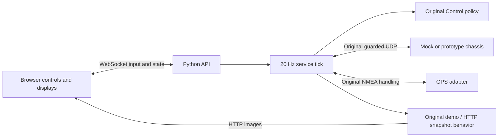

# Browser port implementation map

October 27, 2026. Baseline: upstream main `6ae96d180f9383585edde504e78e7cc7ee3d8b50` (October 26). Scope is the existing desktop prototype's browser UI port. The user explicitly retains camera architecture/encoding decisions; this port implements no new streaming pipeline.

## Where to look

| File | Responsibility |
| --- | --- |
| `web/index.html`, `web/style.css`, `web/app.js` | Layout, browser inputs, plots, image panes |
| `c2_web/api.py` | Local HTTP resources, WebSocket sessions/actions/state |
| `c2_web/runtime.py` | State owner and independent control tick |
| `c2_web/inputs.py` | Headless serial reader and bounded HTTP image fetch |
| `c2_web/legacy.py` | Imports the preserved reusable desktop modules |
| `c2_prototype/core.py`, `rover_link.py` | Existing drive policy and chassis protocol |
| `c2_prototype/gps_input.py`, `navigation.py` | Existing GPS parsing, geometry and comparison |

The browser sends input at 20 Hz only on a focused, visible Drive & arm page; state broadcasts occur at 10 Hz. A browser session heartbeat is separate from a new operator sample. Only a new, increasing input sequence refreshes the original 250 ms input deadline. Stale input disarms and cannot automatically restart motion. Neutral input, released drive hold and deliberate enable are required.

One browser owns controls. Other connected tabs can view, disarm or STOP. Claim, input-source change, focus loss, page change, disconnect and restart disarm. The first session acquires control; subsequent viewers must claim after release. Ownership is local UI coordination, not authentication.

The original UDP protocol retains its session/epoch/sequence checks, enable acknowledgment, 350 ms feedback deadline and independent receiver watchdog. Browser/server checks do not replace MCU limits or physical emergency stop. The retained direct C2-to-MCU adapter remains the repository's bench prototype; final onboard supervisor/ROS 2 integration is not implemented.

## HTTP / WebSocket boundary

- `/ws`: `{action, data, request_id}` in; `hello`, `state`, `ack` out. Invalid input disarms its owner.
- `/api/health`, `/api/state`, `/api/ports`: local service state and serial enumeration.
- `/api/logs/commands`, `/api/logs/gps`: bounded-memory JSONL downloads.
- `/api/gps/example`: synthetic reference-comparison input.
- `/api/cameras/{id}/image`: cached HTTP JPEG/PNG or generated demo image.

The launcher binds to `127.0.0.1`. Origin/host checks prevent cross-origin control and DNS rebinding. There is no network authentication or public deployment. Image fetching retains the desktop limits: 2 s timeout, 4 MB limit and JPEG/PNG content, with a 16 MP dimension cap and no redirects. Image polling is separate from the control tick.

## Retained semantics

GGA position expires after 2.5 s; RMC speed does not revive a stale fix. Synthetic GPS is labeled; scatter describes precision rather than absolute accuracy. Reference comparison uses the original shared-origin, timestamp interpolation rules. The drive pose is a toy command model, not measured odometry. Arm jog is a preview and RC is emulated. Battery telemetry is unavailable.

The original desktop and nested source copies remain unchanged. Refer to their `GPS_COMPARISON.md`, `ARM_INTERFACE_PLAN.md`, `ROS2_INTERFACE_PLAN.md` and firmware documentation for existing engineering context. This AI-assisted implementation requires substantive human review and hardware validation, plus the course's applicable disclosure/approval.
