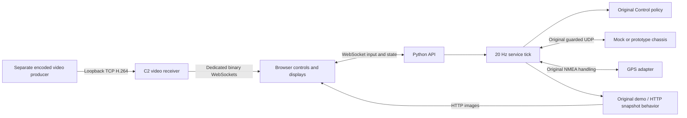

# Browser port implementation map

October 29, 2026. Baseline: upstream NET5/recovery `971aec7` (merged from c2-net5-recovery); main remains `6ae96d1`. Scope is the existing desktop prototype's browser UI port. The user explicitly retains camera architecture/encoding decisions. A subsequently authorized local loopback TCP receiver and five-feed H.264 browser player are documented in `VIDEO_RECEIVER.md`; source generation and video encoding remain in the separate lab.

## Where to look

| File | Responsibility |
| --- | --- |
| `web/index.html`, `web/style.css`, `web/app.js` | Layout, browser inputs, plots, image panes |
| `c2_web/api.py` | Local HTTP resources, WebSocket sessions/actions/state |
| `c2_web/runtime.py` | State owner and independent control tick |
| `web/live-video.js`, `live-video.css` | One five-camera panel shared by Drive/Cameras; view selection and native decode |
| `c2_web/video_receiver.py`, `video_wire.py` | Bounded passive TCP receive, framing, ACK and encoded-video relay |
| `c2_web/inputs.py` | Headless serial reader and bounded HTTP image fetch |
| `c2_web/legacy.py` | Imports the preserved reusable desktop modules |
| `c2_prototype/core.py`, `rover_link.py` | Existing drive policy and chassis protocol |
| `c2_prototype/gps_input.py`, `navigation.py` | Existing GPS parsing, geometry and comparison |

The browser sends input at 20 Hz only on a focused, visible Drive & arm page; state broadcasts occur at 10 Hz. A browser session heartbeat is separate from a new operator sample. Only a new, increasing input sequence refreshes the original 250 ms input deadline. Stale input disarms and cannot automatically restart motion. Neutral input, released drive hold and deliberate enable are required.

Drive and Cameras move the same video panel between page slots, retaining at most one video socket/decoder per camera in this tab. Large-view selection only changes layout; it never writes priorities or operator samples. Other routes and hidden tabs release video resources. The command model remains available in an expandable Drive panel.

One browser owns controls. Other connected tabs can view, disarm or STOP. Claim, input-source change, focus loss, page change, disconnect and restart disarm. The first session acquires control; subsequent viewers must claim after release. Ownership is local UI coordination, not authentication.

The original UDP protocol retains its session/epoch/sequence checks, enable acknowledgment, 350 ms feedback deadline and independent receiver watchdog. Browser/server checks do not replace MCU limits or physical emergency stop. The retained direct C2-to-MCU adapter remains the repository's bench prototype; the separate upstream ROS chassis interface is exposed through an optional ROS adapter and a host-policy OC loopback. DDS is not available or validated on this Mac.

The browser adds a conservative direct-link Enable gate: fresh feedback must acknowledge a post-handshake command before ARM can be requested. A delayed initial HELLO can otherwise look fresh while its original send timestamp is close to the unchanged 350 ms deadline. This gate does not queue Enable, alter timeout limits or enable on confirmation; the operator must click deliberately. Canonical NET5 source and the separately pinned ROS transport remain intact.

## HTTP / WebSocket boundary

- `/ws`: `{action, data, request_id}` in; `hello`, `state`, `ack` out. Invalid input disarms its owner.
- `/api/health`, `/api/state`, `/api/ports`: local service state and serial enumeration.
- `/api/logs/commands`, `/api/logs/gps`: bounded-memory JSONL downloads.
- `/api/gps/example`: synthetic reference-comparison input.
- `/api/cameras/{id}/image`: cached HTTP JPEG/PNG or generated demo image.
- `/api/live-video/state`, `/api/live-video/restart`: local video listener state/restart.
- `/ws/video/{cam-01..cam-05}`: unchanged H.264 plus bounded metadata, separate from operator authority.

The launcher binds to `127.0.0.1`. Origin/host checks prevent cross-origin control and DNS rebinding. There is no network authentication or public deployment. Image fetching retains the desktop limits: 2 s timeout, 4 MB limit and JPEG/PNG content, with a 16 MP dimension cap and no redirects. Image polling is separate from the control tick.

## Retained semantics

GGA position expires after 2.5 s; RMC speed does not revive a stale fix. Synthetic GPS is labeled; scatter describes precision rather than absolute accuracy. Reference comparison uses the original shared-origin, timestamp interpolation rules. The drive pose is a toy command model, not measured odometry. Arm jog is a preview and RC is emulated. Battery telemetry is unavailable.

The original desktop and nested source copies remain unchanged. Refer to their `GPS_COMPARISON.md`, `ARM_INTERFACE_PLAN.md`, `ROS2_INTERFACE_PLAN.md` and firmware documentation for existing engineering context. This AI-assisted implementation requires substantive human review and hardware validation, plus the course's applicable disclosure/approval.

## Current adapters

`c2_web/onboard.py` wraps the upstream host Supervisor/ChassisBridge or the real OperatorNode when ROS and its built interfaces are installed. Only new browser input calls publish INPUT. Feedback ticks can repeat STOP/DISARM but cannot replay motion. `c2_web/priorities.py` owns a distinct configuration stream, revision/session, UDP publication at 2 Hz and receiver ACK tracking; see VIDEO_PRIORITIES.md. This configuration stream never changes drive-input freshness. The independent receiver is outside this repository.
