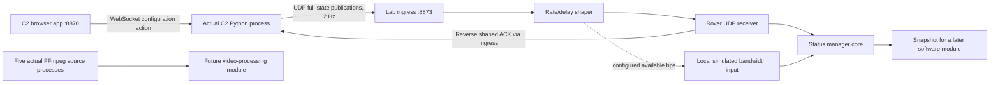

# Status manager: input aggregation only

October 28, 2026. User-directed local implementation, not an approved team architecture. The user clarified that the lab must observe actual processes and receive priorities directly from the separate Python C2 backend. Priority configuration now belongs only in the C2 browser port. This curated prototype runs locally as a separate process; see ../../docs/VIDEO_SYSTEM.md.



## What the module does

`status_manager.py` is standard-library Python. It takes only two typed inputs:

1. **FeedPriorities:** all stream IDs in user order, an enabled count, configuration revision, source-session identity and increasing message sequence.
2. **BandwidthInput:** available bandwidth in **bits per second**, source-session identity and increasing message sequence.

The full order contains each known stream exactly once, including omitted feeds. IDs remain `cam-01` through `cam-05`; display names remain **Camera 01** through **Camera 05**. Positions before the enabled count are ranked 1…N. Remaining positions are explicitly omitted, preserving their order for later re-enabling. All enabled and all omitted are valid.

Output is a combined snapshot containing the full order, enabled count, derived ranked and omitted ID arrays, available bandwidth, source identities/sequences/revision and input freshness. It does not choose bitrate, resolution, frame rate, codec, active encoders, or a congestion response. It never starts/stops sources. An omitted feed is an input instruction for the later module, not a claim that its generator has stopped.

Inputs are immutable dataclasses. Invalid IDs, missing/duplicate IDs, invalid counts, negative/non-integer bandwidth and non-finite data are rejected without replacing the last good input. Repeated/older message sequences do not refresh receipt time. A retired source session cannot overwrite a replacement session. Adapters must establish which publisher is authorized; session IDs are ordering context, not authentication.

**Freshness:** the local bench default is three seconds since monotonic receipt. Missing/stale inputs are flagged, with ages and presence flags. Last good values are retained. This is diagnostic metadata, not an automatic policy for the future consumer. The future module must decide how to handle stale/missing inputs. Output `inputs_ready` means both inputs have been received at least once; the separate stale flags must also be checked.

## Real C2 configuration versus delivered state

Open the **separate** C2 app at <http://127.0.0.1:8870/#cameras>. Its draggable Camera 01–05 list, enabled/omitted divider, arrow controls and keyboard alternatives edit a draft. **Send priorities** updates the actual C2 Python process, guarded by browser ownership and configuration revision. That process owns the order/revision/session and publishes full configurations at 2 Hz independently of browser visibility. This configuration heartbeat never renews drive-input freshness.

The C2 implementation is `c2_web/priorities.py` on `browser-ui-port` commit `b82732d`; its wire contract is documented in that checkout's `docs/VIDEO_PRIORITIES.md`. UDP envelopes contain `type=feed_priorities`, publisher service/PID metadata and the typed priority data. The lab ingress checks schema/IDs, increasing sequences, expected loopback peers and retired sessions, then routes actual received bytes into the shaper. The rover sends ACKs through the reverse shaper; the ingress relays them to the original C2 sender from port 8873. C2 validates session, sequence and the revision originally sent. Session/PID metadata is local diagnostic evidence, not authentication.

The lab's external C2 node is read-only. It shows the actual sender endpoint, PID, session, sequence and input age. The link and core show the lab PID; expanded source rows show their FFmpeg PIDs. These are process observations, not separate OS processes for every visual node: the lab adapter, shaper and StatusManager share one asyncio process.

During an outage, the observer can see a new real C2 revision while the rover retains an older stale one. Recovery requires another actual C2 publication; the lab generates no replacement priorities. If the C2 process stops, the observer reports offline after 1.5 s and rover priorities become stale after 3 s. Bandwidth input continues locally. Starting a new C2 process creates a new session; it is accepted and the old session is retired. A C2 process restart resets its transient priority configuration to all five enabled in numeric order. A lab restart resets its link to 10 Mb/s / 40 ms and waits for actual publications. None of these defaults establish mission decisions.

## What the simulated network represents

The C2 publisher and lab run in separate Python processes. Within the lab, four real localhost UDP endpoints form the ingress, uplink shaper, rover receiver and downlink shaper. Ingress defaults to port 8873 (`C2_VIDEO_INGRESS_PORT` can override it); the remaining ports are ephemeral. Packets cross the loopback interface, with expected-peer checks between adapters. The shaper applies payload-plus-28-byte IPv4/UDP serialization time and configurable one-way propagation delay. Propagation can overlap serialization of subsequent packets. Capacity changes affect remaining serialization work in increments of at most about 20 ms plus host scheduling delay. Latency is sampled after serialization. Both directions use the selected capacity independently: **symmetric full duplex**, not a shared half-duplex radio model.

The UI accepts **0–1000 Mb/s** in the number field and **0–2000 ms** one-way delay. The slider covers 0–100 Mb/s for convenient adjustment; the number field permits other values. Mb/s uses decimal million bits/s. Zero capacity drops incoming/queued packets and invalidates in-flight packets, preventing them from reappearing after a quick reconnect. Queue/propagation count is bounded to 16 per direction plus at most one packet currently serializing; overflow is dropped. C2's periodic full-state publication provides recovery rather than a transport retransmission protocol.

The bandwidth value is **manually configured simulation truth**, not measured link throughput. A local simulated estimator sends that value to the rover core at 2 Hz and immediately after a change, including zero during an outage. In a real system the estimator would be a separate adapter/topic. The Status manager should not need to know how the estimate was obtained.

**Current traffic scope:** only priority and acknowledgment messages cross the shaped link. Browser HTTP monitoring/control, full-resolution raw camera feeds and JPEG monitor previews remain local and bypass the shaper. This prevents confusing small control-packet tests with a completed video/network pipeline. The later video module will need an explicit transport adapter before its packets can consume simulated capacity. The simulator does not change macOS interface settings and does not model Wi-Fi contention, interference, FEC, loss bursts, MTU fragmentation, other users' traffic, physical bus timing or DDS overhead. No camera/encoder capacity conclusion follows from this test.

## File and API boundaries

| File | Responsibility |
| --- | --- |
| `status_manager.py` | Pure typed inputs, validation, ordering/freshness and snapshot |
| `status_runtime.py` | External C2 ingress/observer, rover receiver, simulated bandwidth publisher and ACK relay |
| `simulated_link.py` | Rate/delay shaping and loopback socket lifecycle |
| `app.py` | HTTP resources/control; no allocation policy |
| `web/architecture.js` | Read-only process observations, link simulation controls and received-state rendering |
| `ros2_status_adapter.py` | Optional ROS 2 subscriptions/publication around the same core |

| Endpoint | Purpose |
| --- | --- |
| `GET /api/state` | Sources plus complete observed architecture state |
| `POST /api/link` | Set `bandwidth_bps` and one-way `latency_ms` |
| `GET /api/status-manager` | Stable module snapshot for inspection/a later consumer adapter |

Example module output fields (illustrative C2 input, not mission priorities):

```json
{
  "schema_version": 1,
  "ordered_stream_ids": ["cam-05", "cam-01", "cam-02", "cam-03", "cam-04"],
  "enabled_count": 2,
  "ranked_stream_ids": ["cam-05", "cam-01"],
  "omitted_stream_ids": ["cam-02", "cam-03", "cam-04"],
  "available_bandwidth_bps": 2500000,
  "priorities_received": true,
  "bandwidth_received": true,
  "priorities_stale": false,
  "bandwidth_stale": false
}
```

This excerpt omits the snapshot's additional sequence/session/age fields. Encoding Decision now consumes this snapshot; see `ENCODING_DECISION.md`. The StatusManager itself still applies no encoding policy. All adapters/core calls are owned by one asyncio loop; a future multithreaded executor needs an explicit callback-group/locking strategy.

## Verification on the Mac

October 28: 27 automated tests passed after replacing the internal publisher with an external test fixture (test-only). Checks cover pure validation, sequence/session freshness, all/none enabled, actual UDP round trips, zero-capacity/in-flight cancellation, recovery only after external publication, no priority generation before input or after publisher disappearance, publisher replacement/retired-session rejection, HTTP origin boundaries, absence of the lab priority-write endpoint, and ROS message field alignment. The ROS 2 runtime/message package remains uncompiled on this Mac.

Integration evidence in `artifacts/actual-c2-*.json` compares the C2 health API PID to the lab's observed publisher PID, checks they differ from the lab PID, and confirms five actual source PIDs. Browser actions in the real C2 app changed ranking and enabled count; the corresponding revision reached the StatusManager and was acknowledged by the actual backend. During a 0 Mb/s outage the external publisher remained live while rover priorities stayed at the older revision and became stale; restoration delivered the backend's current revision. A separate actual C2-process stop/restart check verifies no fallback publisher and fresh-session reconnection. Example priorities are QA values, not mission decisions.

Camera/raw-frame verification, preview idle behavior and browser screenshots are recorded alongside those artifacts. Pointer dragging retains keyboard/button alternatives; direct pointer gestures still warrant a human interaction check. No physical devices, encoder, DDS network or production video transport were exercised.
